# Casa Modern

Dark (and, for six of them, light) Home Assistant themes: Nocturne, Pelagic (and its Rose, Copper and Ice variants), Aurel, Northstar, Neon Grid, Monolith, Fusion, Bordeaux and Afterglow.

## Install

1. In HACS add this repository as a custom repository (category **Theme**): `https://github.com/Warlord0/casa-modern`.
2. Download it, then restart Home Assistant (or run `frontend.reload_themes`).
3. Pick a theme under **Profile → Browser settings → Theme**.
4. Themes with a light version also get a Dark/Light/Auto setting in the same place. Auto follows the device.

## Themes

12 themes. The six with a second swatch row also have a light mode.

### Casa Modern Nocturne

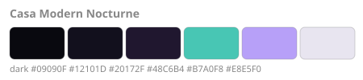

### Casa Modern Pelagic

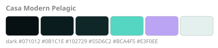

### Casa Modern Pelagic Rose

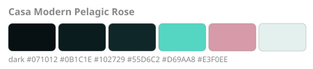

### Casa Modern Pelagic Copper

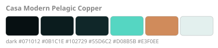

### Casa Modern Pelagic Ice

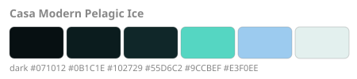

### Casa Modern Aurel

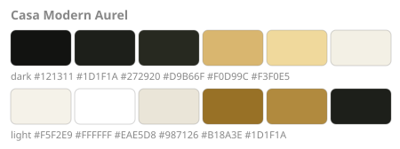

### Casa Modern Northstar

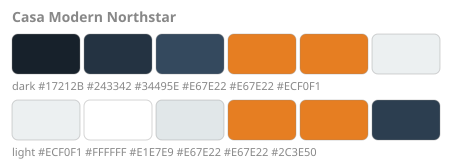

### Casa Modern Neon Grid

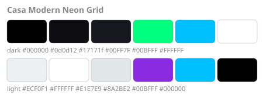

### Casa Modern Monolith

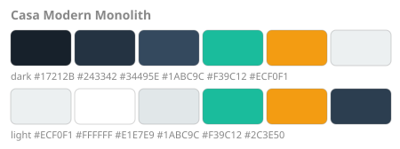

### Casa Modern Fusion

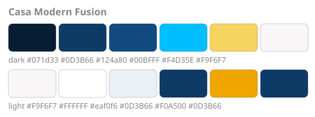

### Casa Modern Bordeaux

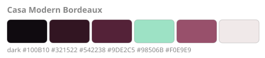

### Casa Modern Afterglow

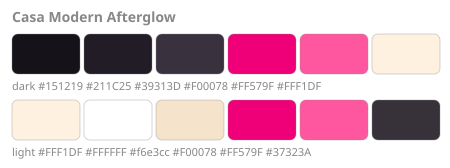

The swatches show page, card, dialog, accent, icon tint and text. Add real screenshots to `images/` for the HACS page.

## Credit

Built on the Noctis theme from [Clooos/Home-Assistant-Mobile-First](https://github.com/Clooos/Home-Assistant-Mobile-First) (MIT, (c) 2023 Cloos Quentin), with the card-mod parts removed and the design tokens extended. See `LICENSE`.
